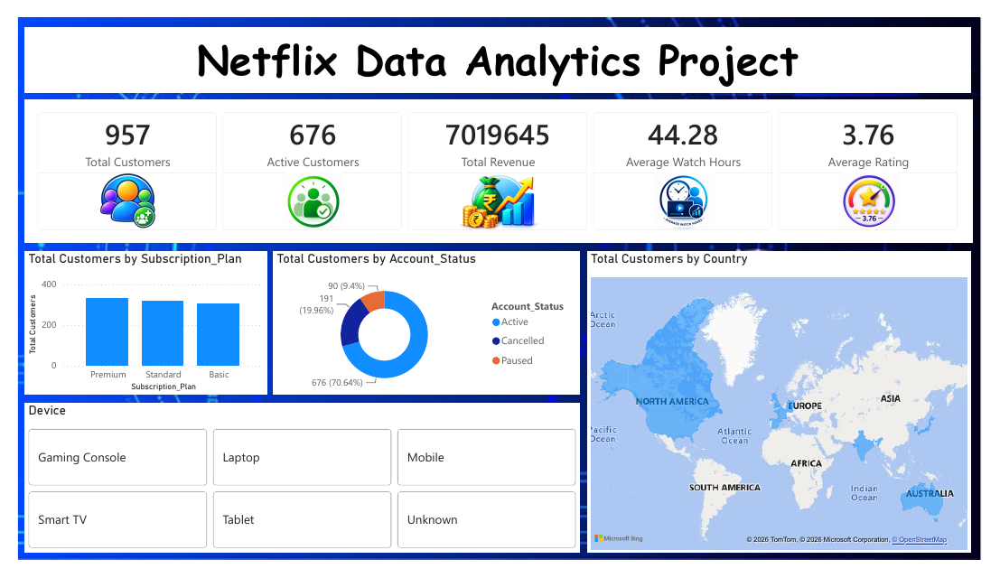
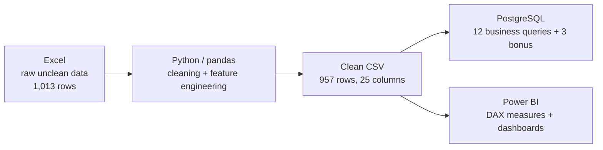
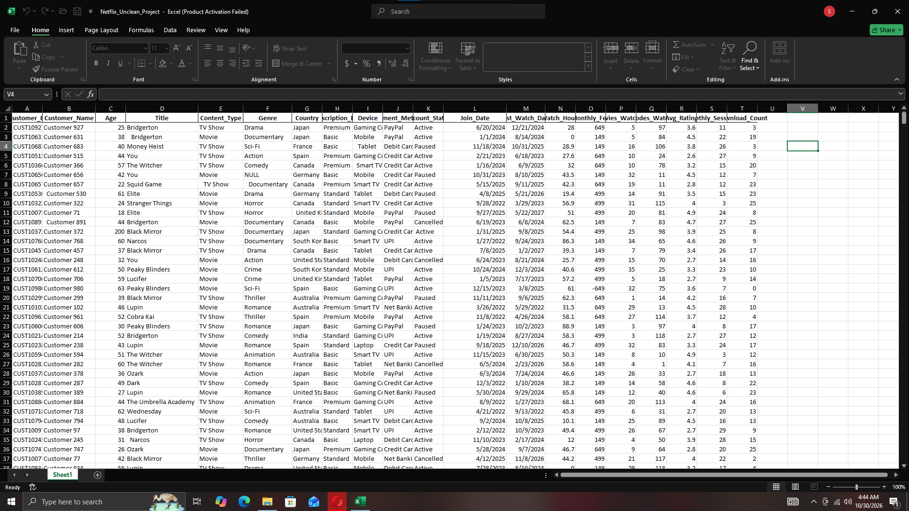
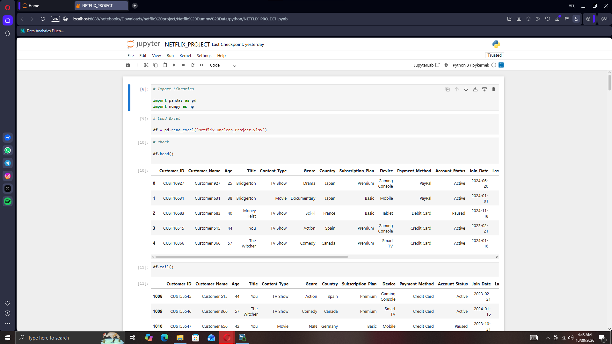
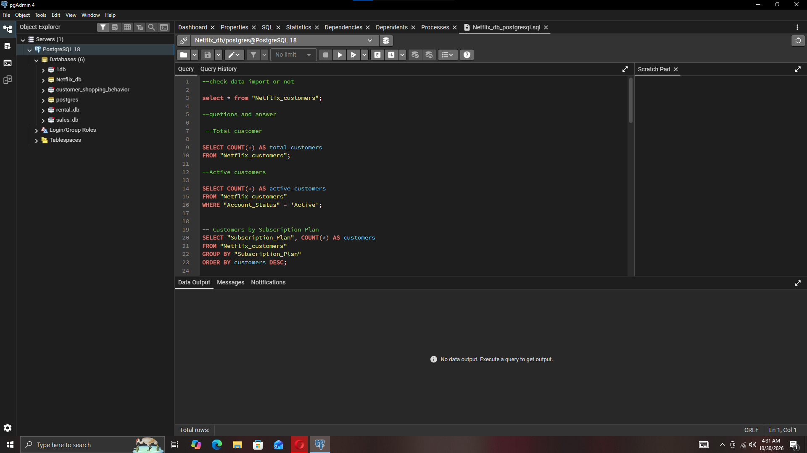
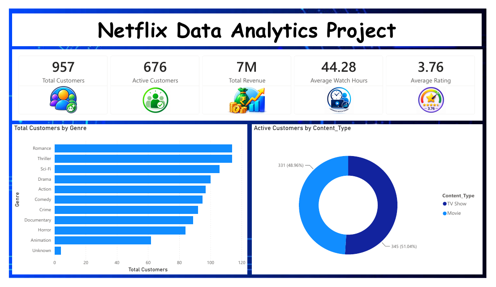
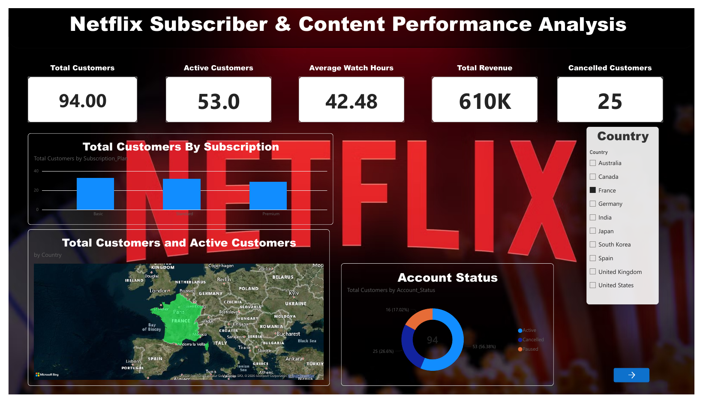
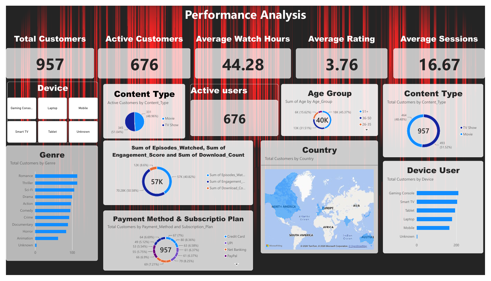
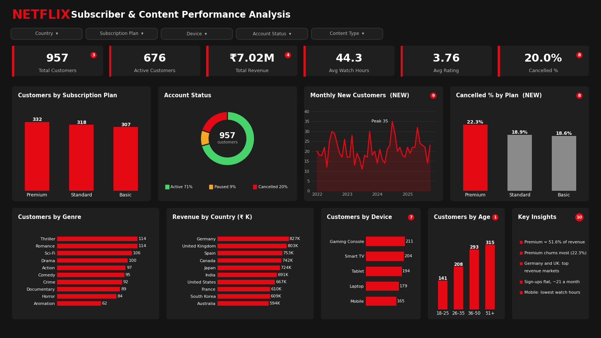

# 🎬 Netflix Subscriber & Content Performance Analysis

**End-to-end data analytics project:** raw Excel data → cleaning with Python (pandas) → analysis with PostgreSQL → interactive Power BI dashboards.




---

## 📌 Table of Contents
1. [Project Overview](#-project-overview)
2. [Business Questions](#-business-questions)
3. [Workflow](#-workflow)
4. [Dataset](#-dataset)
5. [Step 1 – Raw Data (Excel)](#step-1--raw-data-excel)
6. [Step 2 – Data Cleaning (Python)](#step-2--data-cleaning-python)
7. [Step 3 – SQL Analysis (PostgreSQL)](#step-3--sql-analysis-postgresql)
8. [Step 4 – Power BI Dashboards](#step-4--power-bi-dashboards)
9. [Key Insights](#-key-insights)
10. [Recommendations](#-recommendations)
11. [Limitations & Future Improvements](#-limitations--future-improvements)
12. [Repository Structure](#-repository-structure)
13. [How to Run](#-how-to-run)
14. [Author](#-author)

---

## 📖 Project Overview
A streaming company needs to understand **who its subscribers are, what they watch, how engaged they are, and where revenue comes from**. This project takes a messy customer-level Netflix dataset and turns it into clean data, SQL-backed answers and dashboards a manager can use.

> **Note:** the dataset is a synthetic/dummy dataset created for practice. Findings describe this dataset, not real Netflix performance.

## ❓ Business Questions
- How many customers are there, and how many are active?
- Which subscription plan is the most popular, and which brings the most revenue?
- Which countries have the most customers?
- Which genres, content types and devices are most used?
- How engaged are customers (watch hours, sessions, ratings, downloads)?
- Active vs Paused vs Cancelled — what does the customer base look like?
- Who are the high-value customers?

## 🔄 Workflow


## 🗂 Dataset
| Item | Detail |
|---|---|
| Raw file | `data/raw/Netflix_Unclean_Project.xlsx` (1,013 rows × 20 columns) |
| Clean file | `data/clean/Netflix_Clean_Data.csv` (957 rows × 25 columns) |
| Grain | One row per customer, with the title/genre they watched |

Full column descriptions: [`docs/data_dictionary.md`](docs/data_dictionary.md)

---

## Step 1 – Raw Data (Excel)
The raw file was deliberately dirty. Problems found during inspection:

- Invalid ages (e.g. `-10`, `200`)
- Negative values (e.g. `Monthly_Fee = -649`)
- Missing values in `Genre`, `Country`, `Device`, `Payment_Method`
- Placeholder text such as `NULL`, `N/A`, blanks and spaces
- Extra leading/trailing spaces and inconsistent text case
- Duplicate rows



## Step 2 – Data Cleaning (Python)
Notebook: [`notebooks/Netflix_Data_Cleaning.ipynb`](notebooks/Netflix_Data_Cleaning.ipynb)



| # | Cleaning step | Result |
|---|---|---|
| 1 | Load Excel, inspect with `head`, `tail`, `shape`, `info`, `describe` | 1,013 rows × 20 columns |
| 2 | Remove exact duplicate rows | −5 rows → 1,008 |
| 3 | Replace `N/A`, `NULL`, blank, space with `NaN` | Real nulls exposed |
| 4 | Strip extra spaces from all text columns | Consistent text |
| 5 | Standardise case (`str.title()`) for Country, Genre, Plan, Status | One spelling per category |
| 6 | Convert numeric columns with `pd.to_numeric(errors="coerce")` | Correct data types |
| 7 | Keep only valid ages (18–100) | −5 rows → 1,003 |
| 8 | Remove negative `Watch_Hours` / `Monthly_Fee` | −8 rows → 995 |
| 9 | Convert `Join_Date`, `Last_Watch_Date` to datetime | Valid dates |
| 10 | Fill missing `Genre`, `Device`, `Payment_Method` with `Unknown` | No nulls in these columns |
| 11 | Feature engineering (5 new columns, below) | 25 columns |
| 12 | Remove rows with remaining nulls (37 with zero watch hours → no `Watch_Category`, 1 with missing `Country`) | −38 rows → **957** |
| 13 | Final quality check (0 nulls, 0 duplicates) and export to CSV | `Netflix_Clean_Data.csv` |

**Engineered features**

| Feature | Logic |
|---|---|
| `Customer_Revenue` | `Monthly_Fee × Monthly_Sessions` |
| `Engagement_Score` | `Watch_Hours + Monthly_Sessions + Download_Count` |
| `Watch_Category` | Low (>0–20), Medium (20–50), High (50–100), Very High (>100) hours |
| `Age_Group` | 18-25, 26-35, 36-50, 51+ |
| `Active_Flag` | 1 if `Account_Status = Active`, else 0 |

The cleaned DataFrame is then loaded into PostgreSQL with `pandas.to_sql()` through SQLAlchemy.

## Step 3 – SQL Analysis (PostgreSQL)
File: [`sql/netflix_analysis.sql`](sql/netflix_analysis.sql) — 21 queries in three groups:

| Group | Queries | Techniques |
|---|---|---|
| Business questions | Q1–Q12 | `COUNT`, `SUM`, `AVG`, `GROUP BY`, `ORDER BY` |
| Bonus | B1–B3 | Revenue share %, churn rate by plan, revenue by country |
| Advanced | W1–W6 | CTEs and window functions: `DENSE_RANK`, `ROW_NUMBER`, `RANK`, `LAG`, `NTILE`, running `SUM() OVER` |

The advanced queries answer: top 3 engaged customers per country, monthly new customers with month-on-month change and running total, genre share of all customers, most popular title per genre, cancellation rate by engagement quartile, and a country revenue Pareto view.



Example – monthly new customers with `LAG()` and a running total:
```sql
WITH monthly AS (
    SELECT DATE_TRUNC('month', "Join_Date") AS join_month,
           COUNT(*) AS new_customers
    FROM "Netflix_customers"
    GROUP BY 1
)
SELECT TO_CHAR(join_month, 'YYYY-MM') AS month,
       new_customers,
       LAG(new_customers) OVER (ORDER BY join_month) AS prev_month,
       SUM(new_customers) OVER (ORDER BY join_month) AS running_total
FROM monthly
ORDER BY join_month;
```

Example – revenue share by plan:
```sql
SELECT "Subscription_Plan",
       SUM("Customer_Revenue") AS revenue,
       ROUND(100.0 * SUM("Customer_Revenue")
             / SUM(SUM("Customer_Revenue")) OVER (), 1) AS revenue_pct
FROM "Netflix_customers"
GROUP BY "Subscription_Plan"
ORDER BY revenue DESC;
```

## Step 4 – Power BI Dashboards
DAX measures: [`powerbi/dax_measures.dax`](powerbi/dax_measures.dax)

> **Data note:** after importing the data into Power BI, rows with null values were removed (Power Query). The same step is now part of the Python notebook, so the clean CSV, the PostgreSQL table and the dashboards all use the same **957 customers**.

| Measure | Logic |
|---|---|
| Total Customers | `COUNTROWS(netflix_customers)` |
| Active / Cancelled Customers | `CALCULATE([Total Customers], Account_Status = ...)` |
| Total Revenue | `SUM(Customer_Revenue)` |
| Average Watch Hours / Rating / Sessions | `AVERAGE(...)` |

### 1) Overview – KPIs, plans, status, geography, devices


### 2) Content analysis – genres and content type


### 3) Country drill-down – slicer applied (France)


### 4) Performance analysis – engagement, age group, payment methods


### 5) Redesign concept (layout planned for the next version)
A cleaner single-page layout with new churn-by-plan and monthly-joins visuals. This is a design reference, not a Power BI export.



**KPIs on the dashboards:** 957 customers · 676 active · revenue 7,019,645 · 44.28 avg watch hours · 3.76 avg rating · 16.67 avg sessions.

---

## 💡 Key Insights
*(based on the 957 customers in the Power BI dataset)*

1. **Healthy base:** 70.6% of customers are Active, 20.0% Cancelled, 9.4% Paused.
2. **Premium drives revenue:** plans are almost evenly split by customers (Premium 332, Standard 318, Basic 307) but Premium generates **51.6%** of revenue, Standard 37.6% and Basic only 10.8%.
3. **Premium also has the highest cancellation rate** (22.3% vs 18.9% Standard and 18.6% Basic) — the biggest revenue segment is also the one to protect.
4. **Genres:** Romance and Thriller lead with 114 customers each, followed by Sci-Fi (106). Animation is the smallest named genre (62) but has the **highest average rating (3.96)**.
5. **Content type:** TV Shows (51.5%) are slightly ahead of Movies (48.5%).
6. **Devices:** Gaming Console (211) and Smart TV (204) lead; Mobile is lowest in users (165) and in average watch hours (41.3 vs 46.2 on Gaming Console).
7. **Markets:** Spain has the most customers (102), but **Germany (827K) and the UK (803K) bring the most revenue**; Australia is lowest (594K).
8. **Audience:** 63.5% of customers are aged 36 and above (36-50 and 51+).
9. **Engagement is fairly even across plans** — Basic users actually watch the most on average (46.5 hrs vs 42.5 for Standard).
10. **Sign-ups are flat, not growing:** about 20–22 new customers a month across 46 months (Jan 2022 – Oct 2025), with a peak of 35 in July 2024 and a low of 11 in July 2023.
11. **More engaged customers cancel less:** the top engagement quartile has a 17.1% cancellation rate versus 20.5–21.8% in the other three quartiles (a modest gap).
12. **Revenue is spread across markets:** the top 5 countries (Germany, UK, Spain, Canada, Japan) bring 54.8% of revenue, so no single country dominates.

## ✅ Recommendations
- **Retention for Premium:** run win-back offers or loyalty perks for Premium subscribers, since they carry most of the revenue and churn the most.
- **Upsell Basic → Standard/Premium:** Basic users are highly engaged but contribute only ~11% of revenue.
- **Prioritise high-revenue markets** (Germany, UK, Spain) for marketing and content localisation.
- **Invest in Romance, Thriller and Sci-Fi catalogue**, and promote highly rated Animation titles to grow that segment.
- **Improve the mobile experience** (downloads, short-form discovery) to lift low mobile watch time.

---

## ⚠️ Limitations & Future Improvements
Being upfront about the data:

- **Null rows were removed, not imputed.** 38 rows (37 customers with zero watch hours and 1 with a missing country) were dropped. Customers with zero watch hours are real subscribers, so a future version could keep them with a `No Activity` watch category instead of removing them.
- **`Customer_Revenue` is a proxy** (`Monthly_Fee × Monthly_Sessions`), not actual billed revenue. Fees look like INR (₹149 / ₹499 / ₹649).
- **Future dates:** some `Last_Watch_Date` values fall after today (up to Aug 2027) and are not yet validated.
- **Possible duplicate customers:** a few `Customer_Name` values repeat under different `Customer_ID`s.
- Synthetic data: no real-world conclusions should be drawn.

---

## 📁 Repository Structure
```
netflix-data-analytics-project/
├── README.md
├── requirements.txt
├── .gitignore
├── data/
│   ├── raw/Netflix_Unclean_Project.xlsx
│   └── clean/Netflix_Clean_Data.csv
├── notebooks/
│   └── Netflix_Data_Cleaning.ipynb
├── sql/
│   └── netflix_analysis.sql
├── powerbi/
│   ├── dax_measures.dax
│   └── README.md
├── docs/
│   └── data_dictionary.md
└── screenshots/       # all project screenshots, numbered in workflow order
```

## ▶️ How to Run
```bash
# 1. Clone
git clone https://github.com/bhor633/Netflix-Data-Analytics-Project.git
cd Netflix-Data-Analytics-Project

# 2. Install dependencies
pip install -r requirements.txt

# 3. Run the cleaning notebook
jupyter notebook notebooks/Netflix_Data_Cleaning.ipynb
```
**PostgreSQL (optional):** create a database named `Netflix_db`, set your password as an environment variable (`DB_PASSWORD`), and run the last two notebook cells to load the table. Then run `sql/netflix_analysis.sql` in pgAdmin.

**Power BI:** import `data/clean/Netflix_Clean_Data.csv` (957 rows, no nulls), name the table `netflix_customers`, and add the measures from `powerbi/dax_measures.dax`.

## 👤 Author
**Bhor Singh** — Aspiring Data Analyst, New Delhi, India
Skills: SQL (PostgreSQL) · Power BI · Python · Excel
GitHub: [@bhor633](https://github.com/bhor633)

⭐ If you found this project useful, consider giving it a star!
